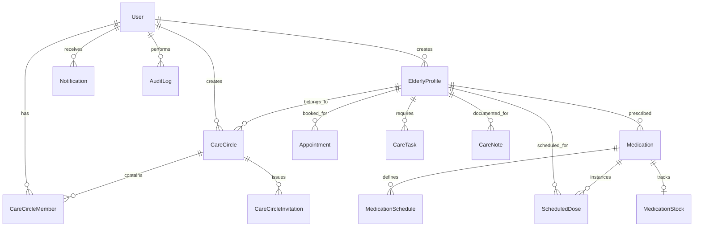

# CARENEST — Database Architecture & Entity Specifications

CareNest runs on **PostgreSQL 18** with **Prisma 7.10.1** and `@prisma/adapter-pg`.

---

## 1. Entity-Relationship Overview

---

## 2. Table Specifications

### 2.1 `User`
Stores system accounts for Seniors, Family Coordinators, Caretakers, and Admins.
- `id` (UUID, PK)
- `email` (Unique, indexed)
- `name` (String)
- `passwordHash` (Bcrypt hash)
- `role` (`UserRole`: `SENIOR`, `FAMILY`, `CARETAKER`, `ADMIN`)
- `phoneNumber` (Optional String)
- `avatarUrl` (Optional String)
- `isActive` (Boolean, default: true)
- `createdAt`, `updatedAt` (DateTime)

### 2.2 `ElderlyProfile`
Supports multiple elderly loved ones per family account with separate clinical profiles.
- `id` (UUID, PK)
- `name` (Full legal or clinical name)
- `preferredName` (e.g. "Grandma Eleanor")
- `dateOfBirth` (DateTime)
- `bloodGroup` (e.g. "A+", "O+")
- `allergies` (Text array)
- `medicalConditions` (Text array)
- `emergencyContactName`, `emergencyContactPhone` (Mandatory emergency dial)
- `isSeniorModeActive` (Boolean UI mode toggle)
- `seniorPin` (Hashed 4-digit PIN for rapid simplified senior login)
- `createdById` (FK -> User)

### 2.3 `CareCircle` & `CareCircleMember`
Forms the collaborative group around a specific elderly individual.
- `careCircleId` (FK -> CareCircle)
- `userId` (FK -> User)
- `role` (`CircleRole`: `ADMIN`, `FAMILY_MEMBER`, `CARETAKER`, `SENIOR`)
- `permissions` (Text array of granular permission flags)
- `isActive` (Boolean)
- Unique constraint: `[careCircleId, userId]`

### 2.4 `CareCircleInvitation`
Secure, single-use, expiring invitations.
- `token` (Unique 64-hex crypto token)
- `email` (Recipient email)
- `role` (`CircleRole`)
- `status` (`PENDING`, `ACCEPTED`, `EXPIRED`, `REVOKED`)
- `expiresAt` (DateTime, 7-day window)

### 2.5 `Medication`, `MedicationSchedule`, `MedicationStock`
Complete lifecycle management with automated inventory decrements:
- `Medication`: clinical info, strength, dosage form, prescribing doctor, Rx number.
- `MedicationSchedule`: frequency (`DAILY`, `WEEKLY`, `AS_NEEDED`), `timesOfDay` array, dosage quantity.
- `MedicationStock`: `currentStock`, `unit`, `refillThreshold`, `lastRefillDate`.

### 2.6 `ScheduledDose`
Audited record of every scheduled dose instance:
- `status`: `SCHEDULED`, `TAKEN`, `MISSED`, `SKIPPED`, `UNCONFIRMED`
- `scheduledAt`, `confirmedAt`, `confirmedById`
- `gracePeriodMinutes`: default 45 minutes
- `escalationLevel`: `0` (None), `1` (Caretaker alerted), `2` (Family urgent escalation)
- `idempotencyKey`: Unique string preventing duplicate doses or alerts

### 2.7 `CareTask` & `CareNote`
Professional caretaker coordination:
- `CareTask`: title, priority (`LOW`, `MEDIUM`, `HIGH`, `URGENT`), `dueDate`, `completedAt`, `completedById`.
- `CareNote`: `category` (`HEALTH_UPDATE`, `HANDOVER`, `OBSERVATION`, `MOOD`, `INCIDENT`), `vitalSigns` JSON (`bloodPressure`, `heartRate`, `bloodGlucose`, `temperature`), `shiftHandoverToId`.

### 2.8 `AuditLog`
Immutable relational audit trail tracking every dose confirmation, prescription change, invitation, escalation, and permission revocation.
